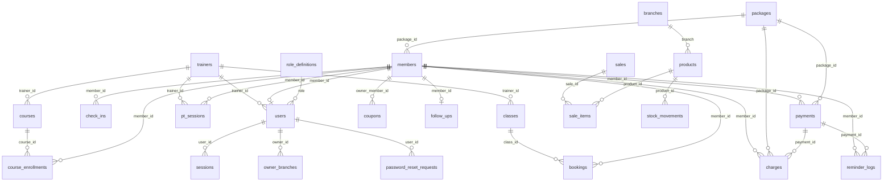

# FitFlow — Data Dictionary (พจนานุกรมข้อมูล)

อธิบายทุกตารางในฐานข้อมูล MySQL ของ FitFlow ว่าเก็บอะไร และแต่ละคอลัมน์หมายถึงอะไร · ต้นฉบับคือ [`prisma/schema.prisma`](../prisma/schema.prisma) — แก้ schema แล้วต้องอัปเดตไฟล์นี้ด้วย

## ข้อตกลงทั่วไป

| เรื่อง | รายละเอียด |
|---|---|
| ชื่อตาราง/คอลัมน์ | snake_case (ชื่อตารางเป็นพหูพจน์) เช่น `members`, `created_at` (ในโค้ด Prisma ใช้ชื่อ camelCase เช่น `createdAt`) |
| รหัส (id) | ข้อความ UUIDv7 ยาวไม่เกิน 40 ตัว — ยกเว้นตารางที่ใช้รหัสอ่านง่ายเป็น PK เช่น `packages.id` = `monthly`, `coupons.code` = `RENEW10` |
| เงิน | จำนวนเต็มหน่วย**สตางค์** (฿1 = 100) ห้ามใช้ทศนิยม — คอลัมน์ลงท้าย `_satang` |
| วันที่ / เวลา | `DATE` = วันล้วนตามเวลาไทย · `DATETIME(3)` = **เวลาไทย (UTC+7)** เปิด DB ดูตรง ๆ ได้เวลาเดียวกับหน้าจอ (เช่น `18:31` = 18:31 น.) — ตั้งแต่ migration 0024 · ในโค้ดยังเป็น `Date`/ISO (UTC) เหมือนเดิม: `db.thai-time.ts` บวก 7 ชั่วโมงตอนเขียน และตีความค่าใน DB เป็น +07:00 ตอนอ่าน · session `time_zone` = `+07:00` (`thaiSession` ใน db.ts, `connectionConfig` ใน seed.mjs) จึง `NOW()` / `CURRENT_TIMESTAMP` ฝั่ง MySQL ก็เป็นเวลาไทย · SQL ตรงหรือ script อื่นที่เขียนเวลาต้องตั้ง `SET time_zone = '+07:00'` ก่อน |
| รายการหลายค่า | เก็บเป็น `JSON` array เช่น `trainers.specialties`, `reminder_rounds.channels` |
| ตัวอักษร | utf8mb4 (รองรับภาษาไทยและ emoji) |
| Track log | ตารางที่แก้ไขได้มี `created_at` `created_by_id` `created_by_name` `updated_at` `updated_by_id` `updated_by_name` — บอกแค่ "ล่าสุด" ส่วนประวัติทุกครั้งอยู่ใน `audit_logs` ([AUDIT.md](AUDIT.md)) · `*_by_id` ไม่ผูก FK ผู้ใช้จึงลบได้โดยไม่กระทบข้อมูล |
| ข้อมูลส่วนบุคคล | `members`, `users` = ข้อมูลส่วนบุคคล · `health_profiles`, `meal_logs` = ข้อมูลสุขภาพ (PDPA ม.26) เห็นเฉพาะเจ้าของบัญชี |

สัญลักษณ์ในตาราง: **PK** = Primary key · **UQ** = ห้ามซ้ำ · **FK** = อ้างถึงตารางอื่น · ✓ ในช่อง "ว่างได้" = เป็น NULL ได้

## สารบัญ

| กลุ่ม | ตาราง | เก็บอะไร |
|---|---|---|
| บัญชีผู้ใช้และสิทธิ์ | [`users`](#users) | บัญชีเข้าสู่ระบบ ทั้งพนักงานและสมาชิก |
|  | [`role_definitions`](#role_definitions) | บทบาท (role) และรายการสิทธิ์ของแต่ละบทบาท |
|  | [`sessions`](#sessions) | การเข้าสู่ระบบที่ยังใช้งานอยู่ (session ฝั่ง server) |
|  | [`password_reset_requests`](#password_reset_requests) | คำขอรีเซ็ตรหัสผ่านจากหน้า "ลืมรหัสผ่าน" |
| สาขาและแบรนด์ | [`branches`](#branches) | สาขา (ข้อมูลหลัก) |
|  | [`owner_branches`](#owner_branches) | สาขาเพิ่มเติมที่เจ้าของดูแล (สาขาหลักอยู่ที่ `users.branch`) |
|  | [`branch_branding`](#branch_branding) | ชื่อ Gym สีหลัก โลโก้ วิธีรับชำระ หัวใบเสร็จ และรูปแบบเลขที่ใบเสร็จของแต่ละสาขา |
| สมาชิกและแพ็กเกจ | [`members`](#members) | สมาชิกยิม (ข้อมูลส่วนบุคคล PDPA) |
|  | [`packages`](#packages) | แพ็กเกจที่ขาย: รายเดือน/รายปี (time) · PT เป็นครั้ง (pt) · รายวัน (daypass) |
|  | [`check_ins`](#check_ins) | การเข้ายิมแต่ละครั้ง รวมครั้งที่ถูกปฏิเสธ (เช่น หมดอายุ/พักสมาชิก) |
| คลาสและเทรนเนอร์ | [`trainers`](#trainers) | โปรไฟล์เทรนเนอร์ (ข้อมูลที่แสดงให้สมาชิกเห็น) |
|  | [`classes`](#classes) | คลาสกลุ่มแต่ละรอบ (วันเวลา ห้อง ผู้สอน ความจุ) |
|  | [`bookings`](#bookings) | การจองคลาสของสมาชิก |
|  | [`pt_sessions`](#pt_sessions) | นัดเทรนเนอร์ส่วนตัว (PT) |
| การเงิน | [`payments`](#payments) | รายการชำระเงิน / ใบเสร็จ |
|  | [`coupons`](#coupons) | คูปองส่วนลด / โค้ดชวนเพื่อน / คูปองดึงสมาชิกกลับ |
|  | [`charges`](#charges) | รอบตัดบัตรต่ออายุอัตโนมัติ พร้อมประวัติการลองตัดซ้ำ |
|  | [`counters`](#counters) | ตัวนับเลขต่อเนื่อง (รหัสสมาชิก, เลขใบเสร็จ) |
| คอร์สเรียน | [`courses`](#courses) | คอร์สเรียนหลายครั้งที่มีรอบเรียน (เช่น มวยไทย 8 ครั้ง) |
|  | [`course_enrollments`](#course_enrollments) | การสมัครคอร์สของสมาชิก (1 คนต่อ 1 คอร์ส) พร้อมสถานะการชำระ |
| ขายหน้าร้านและสต็อก | [`products`](#products) | สินค้าที่ขายหน้าร้าน (น้ำ อาหารเสริม อุปกรณ์) และจำนวนคงเหลือ |
|  | [`sales`](#sales) | บิลขายหน้าร้าน (POS) |
|  | [`sale_items`](#sale_items) | สินค้าในบิล |
|  | [`stock_movements`](#stock_movements) | ประวัติสต็อกทุกครั้งที่จำนวนเปลี่ยน (รับเข้า ขาย ยกเลิกบิล ปรับยอด) |
| แจ้งเตือนและติดตามสมาชิก | [`reminder_rounds`](#reminder_rounds) | รอบแจ้งเตือนต่ออายุ (ก่อนหมด 7 วัน · 3 วัน · วันหมด · หลังหมด 7 วัน) และข้อความที่ใช้ส่ง |
|  | [`reminder_logs`](#reminder_logs) | ข้อความแจ้งเตือนที่ส่งให้สมาชิกแล้ว และผลว่ากดลิงก์/ชำระเงินหรือไม่ |
|  | [`follow_ups`](#follow_ups) | การติดตามสมาชิกที่หายไป/เสี่ยงหลุด (สมาชิกละ 1 แถว) |
| ฝึกและอาหาร (ข้อมูลส่วนตัวของแต่ละบัญชี) | [`workout_plans`](#workout_plans) | โปรแกรมฝึกของบัญชีหนึ่งในวันหนึ่ง |
|  | [`health_profiles`](#health_profiles) | ข้อมูลร่างกาย = ข้อมูลสุขภาพ (PDPA ม.26) |
|  | [`meal_logs`](#meal_logs) | บันทึกอาหารที่กินในแต่ละวัน |
| ระบบ | [`audit_logs`](#audit_logs) | ประวัติการแก้ไขทุกตาราง: ใคร ทำอะไร กับแถวไหน ค่าเดิม/ค่าใหม่ เมื่อไร |

## บัญชีผู้ใช้และสิทธิ์

### `users`

บัญชีเข้าสู่ระบบ ทั้งพนักงานและสมาชิก — role กำหนดเมนูและสิทธิ์ที่ใช้ได้

| คอลัมน์ | ชนิด | ว่างได้ | ค่าเริ่มต้น | คีย์ | คำอธิบาย |
|---|---|:-:|---|---|---|
| `id` | VARCHAR(40) |  | UUIDv7 | PK | รหัสบัญชี |
| `login` | VARCHAR(120) |  |  | UQ | ชื่อเข้าสู่ระบบ — lowercase — อีเมล เบอร์มือถือ (ตัวเลขล้วน) หรือรหัสพนักงาน |
| `password_hash` | VARCHAR(200) |  |  |  | รหัสผ่านที่ hash แล้ว — scrypt 'salt:hash' (hex) — ห้ามเก็บรหัสผ่านตรง ๆ |
| `role` | VARCHAR(40) |  |  | FK → `role_definitions.id` | บทบาท |
| `name` | VARCHAR(120) |  |  |  | ชื่อ-นามสกุล |
| `nickname` | VARCHAR(60) |  |  |  | ชื่อเล่น (แสดงในเมนู) |
| `branch` | VARCHAR(120) |  |  |  | สาขาหลักของบัญชี (ชื่อสาขาจาก `branches.name`) |
| `trainer_id` | VARCHAR(40) | ✓ |  | FK → `trainers.id` | โปรไฟล์เทรนเนอร์ที่ผูกกับบัญชี — เฉพาะ role = trainer |
| `member_id` | VARCHAR(40) | ✓ |  | UQ · FK → `members.id` | สมาชิกที่ผูกกับบัญชี — เฉพาะ role = member |
| `active` | BOOLEAN |  | true |  | เปิดใช้งาน (false = เข้าสู่ระบบไม่ได้) |
| `active_from` | DATE | ✓ |  |  | ใช้งานได้ตั้งแต่วันที่ — ช่วงวันที่ใช้งานบัญชีได้ (รวมทั้งสองวัน ตามเวลาไทย) — null = ไม่จำกัด |
| `active_to` | DATE | ✓ |  |  | ใช้งานได้ถึงวันที่ (null = ไม่จำกัด) |
| `must_change_password` | BOOLEAN |  | false |  | บังคับเปลี่ยนรหัสผ่าน — true = ต้องเปลี่ยนรหัสผ่านก่อนใช้งาน (บัญชีใหม่หรือบัญชีที่ใช้รหัสผ่านชั่วคราว) |
| `created_at` | DATETIME(3) |  | เวลาปัจจุบัน |  | วันเวลาที่สร้างแถว |
| `updated_at` | DATETIME(3) |  | อัปเดตอัตโนมัติ |  | วันเวลาที่แก้ไขล่าสุด |
| `created_by_id` | VARCHAR(40) | ✓ |  |  | id ของผู้สร้าง (null = ระบบ/ข้อมูลตั้งต้น) |
| `created_by_name` | VARCHAR(120) | ✓ |  |  | ชื่อผู้สร้าง ณ ตอนนั้น |
| `updated_by_id` | VARCHAR(40) | ✓ |  |  | id ของผู้แก้ไขล่าสุด (null = ระบบ) |
| `updated_by_name` | VARCHAR(120) | ✓ |  |  | ชื่อผู้แก้ไขล่าสุด ณ ตอนนั้น |

### `role_definitions`

บทบาท (role) และรายการสิทธิ์ของแต่ละบทบาท — role ระบบลบไม่ได้ · admin สร้าง custom role เพิ่มได้ที่ `/roles`

| คอลัมน์ | ชนิด | ว่างได้ | ค่าเริ่มต้น | คีย์ | คำอธิบาย |
|---|---|:-:|---|---|---|
| `id` | VARCHAR(40) |  |  | PK | รหัสบทบาท เช่น admin, owner, supervisor (a-z ตัวเลข ขีดกลาง) |
| `name` | VARCHAR(80) |  |  |  | ชื่อบทบาทที่แสดง |
| `system` | BOOLEAN |  | false |  | true = บทบาทระบบ (ลบไม่ได้) |
| `permissions` | JSON |  |  |  | รายการสิทธิ์ (JSON array) เช่น ["members.view", "payments.collect"] — ดูความหมายที่ docs/RBAC.md |
| `created_at` | DATETIME(3) |  | เวลาปัจจุบัน |  | วันเวลาที่สร้างแถว |
| `updated_at` | DATETIME(3) |  | อัปเดตอัตโนมัติ |  | วันเวลาที่แก้ไขล่าสุด |
| `created_by_id` | VARCHAR(40) | ✓ |  |  | id ของผู้สร้าง (null = ระบบ/ข้อมูลตั้งต้น) |
| `created_by_name` | VARCHAR(120) | ✓ |  |  | ชื่อผู้สร้าง ณ ตอนนั้น |
| `updated_by_id` | VARCHAR(40) | ✓ |  |  | id ของผู้แก้ไขล่าสุด (null = ระบบ) |
| `updated_by_name` | VARCHAR(120) | ✓ |  |  | ชื่อผู้แก้ไขล่าสุด ณ ตอนนั้น |

### `sessions`

การเข้าสู่ระบบที่ยังใช้งานอยู่ (session ฝั่ง server) — cookie เก็บ token สุ่ม ตารางเก็บแค่ SHA-256 ของ token

| คอลัมน์ | ชนิด | ว่างได้ | ค่าเริ่มต้น | คีย์ | คำอธิบาย |
|---|---|:-:|---|---|---|
| `id` | VARCHAR(40) |  | UUIDv7 | PK | รหัส session |
| `token_hash` | CHAR(64) |  |  | UQ | SHA-256 ของ token ใน cookie (ไม่เก็บ token จริง) |
| `user_id` | VARCHAR(40) |  |  | FK → `users.id` (ลบตาม) | บัญชีที่เข้าสู่ระบบ |
| `expires_at` | DATETIME(3) |  |  |  | วันเวลาหมดอายุ |
| `created_at` | DATETIME(3) |  | เวลาปัจจุบัน |  | วันเวลาที่เข้าสู่ระบบ |
| `created_by_name` | VARCHAR(120) | ✓ |  |  | ชื่อผู้ใช้ ณ ตอนเข้าสู่ระบบ |

- Index: (`user_id`) · (`expires_at`)

### `password_reset_requests`

คำขอรีเซ็ตรหัสผ่านจากหน้า "ลืมรหัสผ่าน" — พนักงานตรวจตัวตนแล้วรีเซ็ตให้

| คอลัมน์ | ชนิด | ว่างได้ | ค่าเริ่มต้น | คีย์ | คำอธิบาย |
|---|---|:-:|---|---|---|
| `id` | VARCHAR(40) |  | UUIDv7 | PK | รหัสคำขอ |
| `user_id` | VARCHAR(40) |  |  | FK → `users.id` (ลบตาม) | บัญชีที่ขอรีเซ็ต |
| `requested_at` | DATETIME(3) |  | เวลาปัจจุบัน |  | วันเวลาที่ส่งคำขอ |
| `resolved_at` | DATETIME(3) | ✓ |  |  | วันเวลาที่ดำเนินการ — null = ยังรอดำเนินการ |
| `resolution` | VARCHAR(20) | ✓ |  |  | ผลการดำเนินการ — reset = รีเซ็ตแล้ว · dismissed = ปิดคำขอโดยไม่รีเซ็ต |
| `resolved_by_id` | VARCHAR(40) | ✓ |  |  | id ของพนักงานที่ดำเนินการ |
| `resolved_by_name` | VARCHAR(120) | ✓ |  |  | ชื่อพนักงานที่ดำเนินการ |

- Index: (`resolved_at`, `requested_at`) · (`user_id`)

## สาขาและแบรนด์

### `branches`

สาขา (ข้อมูลหลัก) — admin จัดการที่เมนูตั้งค่า > สาขา · ตารางอื่นอ้างสาขาด้วย**ชื่อ** (`users.branch`, `owner_branches.branch`, `branch_branding.branch`)

| คอลัมน์ | ชนิด | ว่างได้ | ค่าเริ่มต้น | คีย์ | คำอธิบาย |
|---|---|:-:|---|---|---|
| `id` | VARCHAR(40) |  | UUIDv7 | PK | รหัสสาขา |
| `name` | VARCHAR(120) |  |  | UQ | ชื่อสาขา (ไม่ซ้ำ) — ตารางอื่นอ้างด้วยชื่อนี้ |
| `address` | TEXT | ✓ |  |  | ที่อยู่สาขา |
| `phone` | VARCHAR(20) | ✓ |  |  | เบอร์โทรสาขา (ตัวเลขล้วน) |
| `active` | BOOLEAN |  | true |  | ปิดใช้งาน = ไม่แสดงให้เลือกตอนสร้างบัญชีใหม่ (บัญชีเดิมยังใช้ได้) |
| `created_at` | DATETIME(3) |  | เวลาปัจจุบัน |  | วันเวลาที่สร้างแถว |
| `updated_at` | DATETIME(3) |  | อัปเดตอัตโนมัติ |  | วันเวลาที่แก้ไขล่าสุด |
| `created_by_id` | VARCHAR(40) | ✓ |  |  | id ของผู้สร้าง (null = ระบบ/ข้อมูลตั้งต้น) |
| `created_by_name` | VARCHAR(120) | ✓ |  |  | ชื่อผู้สร้าง ณ ตอนนั้น |
| `updated_by_id` | VARCHAR(40) | ✓ |  |  | id ของผู้แก้ไขล่าสุด (null = ระบบ) |
| `updated_by_name` | VARCHAR(120) | ✓ |  |  | ชื่อผู้แก้ไขล่าสุด ณ ตอนนั้น |

### `owner_branches`

สาขาเพิ่มเติมที่เจ้าของดูแล (สาขาหลักอยู่ที่ `users.branch`) — admin เป็นคนกำหนด

| คอลัมน์ | ชนิด | ว่างได้ | ค่าเริ่มต้น | คีย์ | คำอธิบาย |
|---|---|:-:|---|---|---|
| `owner_id` | VARCHAR(40) |  |  | PK · FK → `users.id` (ลบตาม) | บัญชีเจ้าของ |
| `branch` | VARCHAR(120) |  |  | PK | ชื่อสาขาเพิ่มเติมที่ดูแล |
| `created_at` | DATETIME(3) |  | เวลาปัจจุบัน |  | วันเวลาที่สร้างแถว |
| `created_by_id` | VARCHAR(40) | ✓ |  |  | id ของผู้สร้าง (null = ระบบ/ข้อมูลตั้งต้น) |
| `created_by_name` | VARCHAR(120) | ✓ |  |  | ชื่อผู้สร้าง ณ ตอนนั้น |

- Index: (`branch`)
- Primary key ร่วม: `owner_id`, `branch`

### `branch_branding`

ชื่อ Gym สีหลัก และโลโก้ของแต่ละสาขา — admin ดูภาพรวมและตั้งค่าทุกสาขาที่ `/branding` · owner ตั้งค่าเฉพาะสาขาที่ดูแล · วิธีรับชำระ หัวใบเสร็จ และเลขที่ใบเสร็จตั้งที่ `/payment-settings` (admin ทุกสาขา / owner สาขาที่ดูแล)

| คอลัมน์ | ชนิด | ว่างได้ | ค่าเริ่มต้น | คีย์ | คำอธิบาย |
|---|---|:-:|---|---|---|
| `branch` | VARCHAR(120) |  |  | PK | ชื่อสาขา |
| `gym_name` | VARCHAR(120) | ✓ |  |  | ชื่อ Gym ที่แสดงแทน FitFlow (null = ใช้ค่าเริ่มต้น) |
| `primary_color` | CHAR(7) | ✓ |  |  | สีหลักแบบ #RRGGBB |
| `logo_url` | VARCHAR(2048) | ✓ |  |  | URL โลโก้ (HTTPS) |
| `logo_data` | MEDIUMTEXT | ✓ |  |  | ไฟล์โลโก้ที่อัปโหลด — Base64 ของไฟล์ภาพ raster ขนาดไม่เกิน 5 MB (base64 ≈ 6.7 MB ใน MEDIUMTEXT 16 MB) |
| `logo_content_type` | VARCHAR(40) | ✓ |  |  | ชนิดไฟล์โลโก้ เช่น image/png |
| `payment_methods` | JSON | ✓ |  |  | วิธีชำระที่เปิดใช้ เช่น `["cash","card"]` (null = ค่าเริ่มต้น) |
| `prompt_pay_id` | VARCHAR(20) | ✓ |  |  | เลข PromptPay สำหรับสร้าง QR ตามยอด |
| `prompt_pay_qr_data` | MEDIUMTEXT | ✓ |  |  | รูป QR ที่อัปโหลด (Base64 ≤ 10 MB) — อัปโหลดใหม่แทนที่รูปเดิม · กด "ลบรูป" = null |
| `prompt_pay_qr_content_type` | VARCHAR(40) | ✓ |  |  | ชนิดไฟล์รูป QR |
| `receipt_brand` | VARCHAR(60) | ✓ |  |  | ชื่อบนหัวใบเสร็จ (null = ชื่อ Gym → FITFLOW) |
| `receipt_legal_name` | VARCHAR(200) | ✓ |  |  | ชื่อผู้ประกอบการ (null = `SHOP_LEGAL_NAME`) |
| `receipt_address` | VARCHAR(500) | ✓ |  |  | ที่อยู่บนใบเสร็จ (null = `branches.address` → `SHOP_ADDRESS`) |
| `receipt_tax_id` | VARCHAR(20) | ✓ |  |  | เลขประจำตัวผู้เสียภาษี 13 หลัก (null = `SHOP_TAX_ID`) |
| `receipt_phone` | VARCHAR(30) | ✓ |  |  | เบอร์บนใบเสร็จ (null = `branches.phone` → `SHOP_PHONE`) |
| `receipt_number_format` | VARCHAR(60) | ✓ |  |  | รูปแบบเลขที่ใบเสร็จ เช่น `BKK-{YY}{MM}-{####}` (null = `RC-{YY}{MM}-{####}`) · ตัวแปร `{YYYY}` `{YY}` ปี พ.ศ. `{MM}` `{DD}` `{####}` เลขรัน · ห้ามซ้ำกับสาขาอื่น · เลขรันนับต่อจากเลขสูงสุดของรูปแบบและงวดเดียวกัน (ใช้ร่วมกันทั้ง payments, sales, course_enrollments) |
| `created_at` | DATETIME(3) |  | เวลาปัจจุบัน |  | วันเวลาที่สร้างแถว |
| `updated_at` | DATETIME(3) |  | อัปเดตอัตโนมัติ |  | วันเวลาที่แก้ไขล่าสุด |
| `created_by_id` | VARCHAR(40) | ✓ |  |  | id ของผู้สร้าง (null = ระบบ/ข้อมูลตั้งต้น) |
| `created_by_name` | VARCHAR(120) | ✓ |  |  | ชื่อผู้สร้าง ณ ตอนนั้น |
| `updated_by_id` | VARCHAR(40) | ✓ |  |  | id ของผู้แก้ไขล่าสุด (null = ระบบ) |
| `updated_by_name` | VARCHAR(120) | ✓ |  |  | ชื่อผู้แก้ไขล่าสุด ณ ตอนนั้น |

## สมาชิกและแพ็กเกจ

### `members`

สมาชิกยิม (ข้อมูลส่วนบุคคล PDPA) — แพ็กเกจปัจจุบัน วันหมดอายุ การพักสมาชิก และบัตรต่ออายุอัตโนมัติ

| คอลัมน์ | ชนิด | ว่างได้ | ค่าเริ่มต้น | คีย์ | คำอธิบาย |
|---|---|:-:|---|---|---|
| `id` | VARCHAR(40) |  | UUIDv7 | PK | รหัสสมาชิก (ภายในระบบ) |
| `code` | VARCHAR(20) |  |  | UQ | รหัสบนบัตรสมาชิก เช่น FF-002318 |
| `name` | VARCHAR(120) |  |  |  | ชื่อ-นามสกุล |
| `phone` | VARCHAR(20) |  |  | UQ | เบอร์โทร (เก็บเฉพาะตัวเลข) — ใช้ค้นหาสมาชิกและเป็นชื่อเข้าสู่ระบบของสมาชิก |
| `email` | VARCHAR(160) | ✓ |  |  | อีเมล |
| `joined_on` | DATE |  |  |  | วันที่สมัครครั้งแรก |
| `package_id` | VARCHAR(40) |  |  | FK → `packages.id` | แพ็กเกจปัจจุบัน |
| `expires_on` | DATE |  |  |  | วันหมดอายุสมาชิก |
| `freeze_from` | DATE | ✓ |  |  | วันแรกของการพักสมาชิก (null = ไม่ได้พัก) |
| `freeze_until` | DATE | ✓ |  |  | วันสุดท้ายของการพักสมาชิก |
| `pt_sessions_left` | INT |  | 0 |  | จำนวนครั้ง PT ที่เหลือ |
| `last_check_in_at` | DATETIME(3) | ✓ |  |  | เช็กอินล่าสุด (เก็บซ้ำไว้คัดกรองเร็ว) |
| `note` | TEXT | ✓ |  |  | หมายเหตุของพนักงาน |
| `marketing_consent` | BOOLEAN |  | false |  | ยินยอมรับข่าวสาร/โปรโมชัน แยกจากความยินยอมใช้บริการ (PDPA) |
| `card_brand` | ENUM | ✓ |  |  | ยี่ห้อบัตรที่ใช้ต่ออายุอัตโนมัติ — เก็บแค่ยี่ห้อ/4 หลักท้าย/วันหมดอายุ ไม่เก็บเลขบัตร (`visa` Visa · `mastercard` Mastercard) |
| `card_last4` | CHAR(4) | ✓ |  |  | เลข 4 หลักท้ายของบัตร |
| `card_exp` | VARCHAR(5) | ✓ |  |  | วันหมดอายุบัตร MM/YY |
| `auto_renew_since` | DATE | ✓ |  |  | เริ่มต่ออายุอัตโนมัติตั้งแต่วันที่ (null = ไม่ได้ต่ออายุอัตโนมัติ) |
| `created_at` | DATETIME(3) |  | เวลาปัจจุบัน |  | วันเวลาที่สร้างแถว |
| `updated_at` | DATETIME(3) |  | อัปเดตอัตโนมัติ |  | วันเวลาที่แก้ไขล่าสุด |
| `created_by_id` | VARCHAR(40) | ✓ |  |  | id ของผู้สร้าง (null = ระบบ/ข้อมูลตั้งต้น) |
| `created_by_name` | VARCHAR(120) | ✓ |  |  | ชื่อผู้สร้าง ณ ตอนนั้น |
| `updated_by_id` | VARCHAR(40) | ✓ |  |  | id ของผู้แก้ไขล่าสุด (null = ระบบ) |
| `updated_by_name` | VARCHAR(120) | ✓ |  |  | ชื่อผู้แก้ไขล่าสุด ณ ตอนนั้น |

- Index: (`expires_on`)

### `packages`

แพ็กเกจที่ขาย: รายเดือน/รายปี (time) · PT เป็นครั้ง (pt) · รายวัน (daypass)

| คอลัมน์ | ชนิด | ว่างได้ | ค่าเริ่มต้น | คีย์ | คำอธิบาย |
|---|---|:-:|---|---|---|
| `id` | VARCHAR(40) |  |  | PK | รหัสแพ็กเกจ — slug อ่านง่าย เช่น monthly, 3m, pt10 (ข้อมูลตั้งต้น) · แพ็กเกจที่เพิ่มจากหน้า /packages ได้ UUID |
| `name` | VARCHAR(120) |  |  |  | ชื่อแพ็กเกจ |
| `kind` | ENUM |  |  |  | ชนิดแพ็กเกจ (`time` แพ็กเกจตามระยะเวลา (เดือน/ปี) · `pt` เทรนเนอร์ส่วนตัวเป็นครั้ง · `daypass` ใช้ได้รายวัน) |
| `months` | INT | ✓ |  |  | จำนวนเดือน — kind = time |
| `days` | INT | ✓ |  |  | จำนวนวัน — kind = daypass |
| `sessions` | INT | ✓ |  |  | จำนวนครั้ง PT — kind = pt |
| `price_satang` | INT |  |  |  | ราคา (สตางค์ — ฿1 = 100) |
| `description` | TEXT |  |  |  | คำอธิบายที่แสดงให้ลูกค้า |
| `active` | BOOLEAN |  | true |  | เปิดขาย (false = ซ่อนจากหน้าขาย) |
| `sort_order` | INT |  | 0 |  | ลำดับการแสดงผล |
| `created_at` | DATETIME(3) |  | เวลาปัจจุบัน |  | วันเวลาที่สร้างแถว |
| `updated_at` | DATETIME(3) |  | อัปเดตอัตโนมัติ |  | วันเวลาที่แก้ไขล่าสุด |
| `created_by_id` | VARCHAR(40) | ✓ |  |  | id ของผู้สร้าง (null = ระบบ/ข้อมูลตั้งต้น) |
| `created_by_name` | VARCHAR(120) | ✓ |  |  | ชื่อผู้สร้าง ณ ตอนนั้น |
| `updated_by_id` | VARCHAR(40) | ✓ |  |  | id ของผู้แก้ไขล่าสุด (null = ระบบ) |
| `updated_by_name` | VARCHAR(120) | ✓ |  |  | ชื่อผู้แก้ไขล่าสุด ณ ตอนนั้น |

### `check_ins`

การเข้ายิมแต่ละครั้ง รวมครั้งที่ถูกปฏิเสธ (เช่น หมดอายุ/พักสมาชิก) — บันทึกเวลาเข้าและเวลาออกของแต่ละรอบ

| คอลัมน์ | ชนิด | ว่างได้ | ค่าเริ่มต้น | คีย์ | คำอธิบาย |
|---|---|:-:|---|---|---|
| `id` | VARCHAR(40) |  | UUIDv7 | PK | รหัสการเช็กอิน |
| `member_id` | VARCHAR(40) |  |  | FK → `members.id` (ลบตาม) | สมาชิกที่เช็กอิน |
| `at` | DATETIME(3) |  |  |  | วันเวลาที่เช็กอิน |
| `checked_out_at` | DATETIME(3) | ✓ |  |  | วันเวลาที่เช็กเอาต์ (null = ยังไม่บันทึกเวลาออก) |
| `allowed` | BOOLEAN |  |  |  | ผ่านเข้าได้ (false = ถูกปฏิเสธ) |
| `created_by_id` | VARCHAR(40) | ✓ |  |  | พนักงานที่กดเช็กอิน (null = สมาชิกสแกน QR เอง) |
| `created_by_name` | VARCHAR(120) | ✓ |  |  | ชื่อพนักงานที่กดเช็กอิน |

- Index: (`member_id`, `at`) · (`at`)

## คลาสและเทรนเนอร์

### `trainers`

โปรไฟล์เทรนเนอร์ (ข้อมูลที่แสดงให้สมาชิกเห็น) — บัญชีเข้าสู่ระบบของเทรนเนอร์ผูกผ่าน `users.trainer_id`

| คอลัมน์ | ชนิด | ว่างได้ | ค่าเริ่มต้น | คีย์ | คำอธิบาย |
|---|---|:-:|---|---|---|
| `id` | VARCHAR(40) |  | UUIDv7 | PK | รหัสเทรนเนอร์ |
| `name` | VARCHAR(120) |  |  |  | ชื่อ-นามสกุล |
| `nickname` | VARCHAR(60) |  |  |  | ชื่อเรียก เช่น โค้ชบอส |
| `specialties` | JSON |  |  |  | ความถนัด (JSON array ของข้อความ) — string[] |
| `bio` | TEXT |  |  |  | ประวัติย่อ |
| `color` | VARCHAR(40) |  |  |  | สีประจำตัวในตารางคลาส — สี CSS เช่น var(--color-lime) |
| `created_at` | DATETIME(3) |  | เวลาปัจจุบัน |  | วันเวลาที่สร้างแถว |
| `updated_at` | DATETIME(3) |  | อัปเดตอัตโนมัติ |  | วันเวลาที่แก้ไขล่าสุด |
| `created_by_id` | VARCHAR(40) | ✓ |  |  | id ของผู้สร้าง (null = ระบบ/ข้อมูลตั้งต้น) |
| `created_by_name` | VARCHAR(120) | ✓ |  |  | ชื่อผู้สร้าง ณ ตอนนั้น |
| `updated_by_id` | VARCHAR(40) | ✓ |  |  | id ของผู้แก้ไขล่าสุด (null = ระบบ) |
| `updated_by_name` | VARCHAR(120) | ✓ |  |  | ชื่อผู้แก้ไขล่าสุด ณ ตอนนั้น |

### `classes`

คลาสกลุ่มแต่ละรอบ (วันเวลา ห้อง ผู้สอน ความจุ)

| คอลัมน์ | ชนิด | ว่างได้ | ค่าเริ่มต้น | คีย์ | คำอธิบาย |
|---|---|:-:|---|---|---|
| `id` | VARCHAR(60) |  | UUIDv7 | PK | รหัสรอบคลาส |
| `title` | VARCHAR(120) |  |  |  | ชื่อคลาส เช่น HIIT Burn |
| `trainer_id` | VARCHAR(40) |  |  | FK → `trainers.id` | เทรนเนอร์ผู้สอน |
| `room` | VARCHAR(60) |  |  |  | ห้อง |
| `starts_at` | DATETIME(3) |  |  |  | วันเวลาเริ่ม |
| `minutes` | INT |  |  |  | ความยาว (นาที) |
| `capacity` | INT |  |  |  | จำนวนที่นั่งสูงสุด |
| `level` | VARCHAR(10) |  |  |  | ระดับความยาก: ง่าย / กลาง / หนัก |
| `other_booked` | INT |  | 0 |  | จำนวนผู้จองนอกระบบ — ผู้จองที่จองนอกระบบ (เช่น walk-in ที่เคาน์เตอร์จดไว้) — ค่าปกติ 0 |
| `created_at` | DATETIME(3) |  | เวลาปัจจุบัน |  | วันเวลาที่สร้างแถว |
| `updated_at` | DATETIME(3) |  | เวลาปัจจุบัน · อัปเดตอัตโนมัติ |  | วันเวลาที่แก้ไขล่าสุด |
| `created_by_id` | VARCHAR(40) | ✓ |  |  | id ของผู้สร้าง (null = ระบบ/ข้อมูลตั้งต้น) |
| `created_by_name` | VARCHAR(120) | ✓ |  |  | ชื่อผู้สร้าง ณ ตอนนั้น |
| `updated_by_id` | VARCHAR(40) | ✓ |  |  | id ของผู้แก้ไขล่าสุด (null = ระบบ) |
| `updated_by_name` | VARCHAR(120) | ✓ |  |  | ชื่อผู้แก้ไขล่าสุด ณ ตอนนั้น |

- Index: (`starts_at`)

### `bookings`

การจองคลาสของสมาชิก

| คอลัมน์ | ชนิด | ว่างได้ | ค่าเริ่มต้น | คีย์ | คำอธิบาย |
|---|---|:-:|---|---|---|
| `id` | VARCHAR(40) |  | UUIDv7 | PK | รหัสการจอง |
| `class_id` | VARCHAR(60) |  |  | FK → `classes.id` (ลบตาม) | คลาสที่จอง |
| `member_id` | VARCHAR(40) |  |  | FK → `members.id` (ลบตาม) | สมาชิกที่จอง |
| `status` | ENUM |  | booked |  | สถานะการจอง (`booked` จองแล้ว · `cancelled` ยกเลิก) |
| `created_at` | DATETIME(3) |  | เวลาปัจจุบัน |  | วันเวลาที่สร้างแถว |
| `updated_at` | DATETIME(3) |  | เวลาปัจจุบัน · อัปเดตอัตโนมัติ |  | วันเวลาที่แก้ไขล่าสุด |
| `created_by_id` | VARCHAR(40) | ✓ |  |  | id ของผู้สร้าง (null = ระบบ/ข้อมูลตั้งต้น) |
| `created_by_name` | VARCHAR(120) | ✓ |  |  | ชื่อผู้สร้าง ณ ตอนนั้น |
| `updated_by_id` | VARCHAR(40) | ✓ |  |  | id ของผู้แก้ไขล่าสุด (null = ระบบ) |
| `updated_by_name` | VARCHAR(120) | ✓ |  |  | ชื่อผู้แก้ไขล่าสุด ณ ตอนนั้น |

- Index: (`class_id`, `status`) · (`member_id`, `status`)

### `pt_sessions`

นัดเทรนเนอร์ส่วนตัว (PT) — ทำเสร็จ (done) แล้วหักครั้งจาก `members.pt_sessions_left`

| คอลัมน์ | ชนิด | ว่างได้ | ค่าเริ่มต้น | คีย์ | คำอธิบาย |
|---|---|:-:|---|---|---|
| `id` | VARCHAR(40) |  | UUIDv7 | PK | รหัสนัด |
| `trainer_id` | VARCHAR(40) |  |  | FK → `trainers.id` | เทรนเนอร์ |
| `member_id` | VARCHAR(40) |  |  | FK → `members.id` (ลบตาม) | สมาชิก |
| `starts_at` | DATETIME(3) |  |  |  | วันเวลานัด |
| `minutes` | INT |  |  |  | ความยาว (นาที) |
| `status` | ENUM |  | booked |  | สถานะนัด (`booked` นัดไว้ · `done` เทรนแล้ว (หักครั้ง) · `cancelled` ยกเลิก) |
| `created_at` | DATETIME(3) |  | เวลาปัจจุบัน |  | วันเวลาที่สร้างแถว |
| `updated_at` | DATETIME(3) |  | เวลาปัจจุบัน · อัปเดตอัตโนมัติ |  | วันเวลาที่แก้ไขล่าสุด |
| `created_by_id` | VARCHAR(40) | ✓ |  |  | id ของผู้สร้าง (null = ระบบ/ข้อมูลตั้งต้น) |
| `created_by_name` | VARCHAR(120) | ✓ |  |  | ชื่อผู้สร้าง ณ ตอนนั้น |
| `updated_by_id` | VARCHAR(40) | ✓ |  |  | id ของผู้แก้ไขล่าสุด (null = ระบบ) |
| `updated_by_name` | VARCHAR(120) | ✓ |  |  | ชื่อผู้แก้ไขล่าสุด ณ ตอนนั้น |

- Index: (`trainer_id`, `starts_at`) · (`member_id`, `starts_at`)

## การเงิน

### `payments`

รายการชำระเงิน / ใบเสร็จ — สมัครใหม่ ต่ออายุ ซื้อ PT หรือ Day pass

| คอลัมน์ | ชนิด | ว่างได้ | ค่าเริ่มต้น | คีย์ | คำอธิบาย |
|---|---|:-:|---|---|---|
| `id` | VARCHAR(40) |  | UUIDv7 | PK | รหัสรายการชำระ |
| `receipt_no` | VARCHAR(30) |  |  | UQ | เลขใบเสร็จ — เลขใบเสร็จต่อเนื่อง (ออกจาก counters ใน transaction) |
| `member_id` | VARCHAR(40) |  |  | FK → `members.id` | สมาชิกที่ชำระ |
| `package_id` | VARCHAR(40) |  |  | FK → `packages.id` | แพ็กเกจที่ซื้อ |
| `kind` | ENUM |  |  |  | ประเภทการชำระ (`signup` สมัครใหม่ · `renew` ต่ออายุ · `pt` ซื้อ PT · `daypass` Day pass) |
| `amount_satang` | INT |  |  |  | ยอดสุทธิ (สตางค์) — ยอดสุทธิหลังหักส่วนลด |
| `method` | ENUM |  |  |  | วิธีชำระ (`promptpay` พร้อมเพย์ · `card` บัตรเครดิต/เดบิต · `cash` เงินสด · `transfer` โอนเงิน (แนบสลิป)) |
| `status` | ENUM |  | pending |  | สถานะการชำระ (`pending` รอชำระ · `review` แนบสลิปแล้ว รอตรวจ · `paid` ชำระแล้ว) |
| `created_at` | DATETIME(3) |  | เวลาปัจจุบัน |  | วันเวลาที่สร้างรายการ |
| `paid_at` | DATETIME(3) | ✓ |  |  | วันเวลาที่ชำระสำเร็จ |
| `applied` | BOOLEAN |  | false |  | ใช้สิทธิ์จากการชำระแล้ว — ผลของการชำระ (ต่ออายุ / เพิ่มครั้ง PT) ถูกใช้แล้วหรือยัง — กันต่ออายุซ้ำ |
| `coverage_from` | DATE | ✓ |  |  | วันแรกของสิทธิ์ที่ได้จากการชำระ (พิมพ์ในใบเสร็จ) |
| `coverage_to` | DATE | ✓ |  |  | วันสุดท้ายของสิทธิ์ที่ได้ |
| `received_by` | VARCHAR(120) | ✓ |  |  | ชื่อเจ้าหน้าที่ที่รับเงิน/ยืนยันสลิป (พิมพ์ในใบเสร็จ) |
| `list_price_satang` | INT |  |  |  | ราคาเต็มก่อนลด (สตางค์) |
| `discount_satang` | INT |  | 0 |  | ส่วนลด (สตางค์) |
| `coupon_code` | VARCHAR(40) | ✓ |  |  | โค้ดคูปองที่ใช้ |
| `bonus_days` | INT |  | 0 |  | จำนวนวันใช้งานที่แถมจากคูปอง |
| `updated_at` | DATETIME(3) |  | เวลาปัจจุบัน · อัปเดตอัตโนมัติ |  | วันเวลาที่แก้ไขล่าสุด |
| `created_by_id` | VARCHAR(40) | ✓ |  |  | id ของผู้สร้าง (null = ระบบ/ข้อมูลตั้งต้น) |
| `created_by_name` | VARCHAR(120) | ✓ |  |  | ชื่อผู้สร้าง ณ ตอนนั้น |
| `updated_by_id` | VARCHAR(40) | ✓ |  |  | id ของผู้แก้ไขล่าสุด (null = ระบบ) |
| `updated_by_name` | VARCHAR(120) | ✓ |  |  | ชื่อผู้แก้ไขล่าสุด ณ ตอนนั้น |

- Index: (`status`, `created_at`) · (`member_id`, `created_at`) · (`paid_at`) · (`coupon_code`)

### `coupons`

คูปองส่วนลด / โค้ดชวนเพื่อน / คูปองดึงสมาชิกกลับ

| คอลัมน์ | ชนิด | ว่างได้ | ค่าเริ่มต้น | คีย์ | คำอธิบาย |
|---|---|:-:|---|---|---|
| `code` | VARCHAR(40) |  |  | PK | โค้ดคูปอง (ตัวพิมพ์ใหญ่) เช่น RENEW10 |
| `description` | TEXT |  |  |  | คำอธิบายคูปอง |
| `type` | ENUM |  |  |  | ชนิดส่วนลด (`percent` ลดเป็น % · `baht` ลดเป็นจำนวนเงิน (value เป็นสตางค์) · `days` แถมวันใช้งาน) |
| `value` | INT |  |  |  | มูลค่าส่วนลด — percent = %, baht = สตางค์, days = จำนวนวันที่แถม |
| `kind` | ENUM |  | promo |  | ประเภทคูปอง (`promo` โปรโมชันทั่วไป · `referral` โค้ดชวนเพื่อน (ปิดใช้งานอยู่ — โค้ดเดิมใช้ไม่ได้) · `winback` คูปองดึงสมาชิกที่หายไปกลับมา) |
| `package_ids` | JSON | ✓ |  |  | แพ็กเกจที่ใช้คูปองได้ — string[] ของ package id — null = ใช้ได้ทุกแพ็กเกจ |
| `applies_to` | JSON | ✓ |  |  | ประเภทรายการที่ใช้คูปองได้ (string[]: `membership`, `product`, `course`) — null ของข้อมูลเดิมตีความเป็นสมาชิก/แพ็กเกจเท่านั้น |
| `renew_only` | BOOLEAN |  | false |  | ใช้ได้เฉพาะการต่ออายุ |
| `new_only` | BOOLEAN |  | false |  | ใช้ได้เฉพาะสมาชิกใหม่ |
| `usage_limit` | INT | ✓ |  |  | จำนวนสิทธิ์ทั้งหมด — null = ไม่จำกัดจำนวนสิทธิ์ |
| `used` | INT |  | 0 |  | ใช้ไปแล้วกี่ครั้ง |
| `per_member` | INT |  | 1 |  | สมาชิก 1 คนใช้ได้กี่ครั้ง |
| `terms` | TEXT | ✓ |  |  | เงื่อนไขเพิ่มเติม (ข้อความแสดงให้เคาน์เตอร์/สมาชิกเห็นตอนใช้โค้ด) |
| `min_member_days` | INT | ✓ |  |  | ต้องเป็นสมาชิกมาแล้วอย่างน้อยกี่วัน (นับจาก joined_on) — null = ไม่จำกัด |
| `proof_required` | VARCHAR(200) | ✓ |  |  | หลักฐานที่เคาน์เตอร์ต้องตรวจก่อนใช้ เช่น บัตรนักเรียน — null = ไม่ต้องตรวจ · มีค่า = สมาชิกใช้เองในแอปไม่ได้ |
| `starts_on` | DATE |  |  |  | วันเริ่มใช้คูปอง (จำเป็น; ข้อมูลเดิมใช้วันสร้างคูปอง) |
| `expires_on` | DATE | ✓ |  |  | วันสิ้นสุด (รวมวันดังกล่าว · null = ไม่หมด) |
| `active` | BOOLEAN |  | true |  | เปิดใช้งาน |
| `owner_member_id` | VARCHAR(40) | ✓ |  | FK → `members.id` (ตั้งเป็น NULL) | สมาชิกเจ้าของโค้ด — เจ้าของโค้ดชวนเพื่อน / คูปองดึงกลับ |
| `created_at` | DATETIME(3) |  | เวลาปัจจุบัน |  | วันเวลาที่สร้างแถว |
| `updated_at` | DATETIME(3) |  | เวลาปัจจุบัน · อัปเดตอัตโนมัติ |  | วันเวลาที่แก้ไขล่าสุด |
| `created_by_id` | VARCHAR(40) | ✓ |  |  | id ของผู้สร้าง (null = ระบบ/ข้อมูลตั้งต้น) |
| `created_by_name` | VARCHAR(120) | ✓ |  |  | ชื่อผู้สร้าง ณ ตอนนั้น |
| `updated_by_id` | VARCHAR(40) | ✓ |  |  | id ของผู้แก้ไขล่าสุด (null = ระบบ) |
| `updated_by_name` | VARCHAR(120) | ✓ |  |  | ชื่อผู้แก้ไขล่าสุด ณ ตอนนั้น |

### `charges`

รอบตัดบัตรต่ออายุอัตโนมัติ พร้อมประวัติการลองตัดซ้ำ

| คอลัมน์ | ชนิด | ว่างได้ | ค่าเริ่มต้น | คีย์ | คำอธิบาย |
|---|---|:-:|---|---|---|
| `id` | VARCHAR(40) |  | UUIDv7 | PK | รหัสรอบตัดบัตร |
| `member_id` | VARCHAR(40) |  |  | FK → `members.id` (ลบตาม) | สมาชิก |
| `package_id` | VARCHAR(40) |  |  | FK → `packages.id` | แพ็กเกจที่ต่ออายุ |
| `amount_satang` | INT |  |  |  | ยอดที่ตัด (สตางค์) |
| `due_on` | DATE |  |  |  | วันที่ครบกำหนดตัด |
| `attempts` | JSON |  |  |  | ประวัติการลองตัดบัตร (JSON array: วันที่ · ผ่านหรือไม่ · เหตุผล) |
| `status` | ENUM |  | retrying |  | สถานะการตัดบัตร (`retrying` ตัดไม่ผ่าน กำลังลองใหม่ · `failed` ลองครบแล้วไม่ผ่าน · `paid` ตัดผ่านแล้ว) |
| `payment_id` | VARCHAR(40) | ✓ |  | FK → `payments.id` | รายการชำระที่เกิดขึ้นเมื่อตัดบัตรผ่าน |
| `created_at` | DATETIME(3) |  | เวลาปัจจุบัน |  | วันเวลาที่สร้างแถว |
| `updated_at` | DATETIME(3) |  | เวลาปัจจุบัน · อัปเดตอัตโนมัติ |  | วันเวลาที่แก้ไขล่าสุด |
| `created_by_id` | VARCHAR(40) | ✓ |  |  | id ของผู้สร้าง (null = ระบบ/ข้อมูลตั้งต้น) |
| `created_by_name` | VARCHAR(120) | ✓ |  |  | ชื่อผู้สร้าง ณ ตอนนั้น |
| `updated_by_id` | VARCHAR(40) | ✓ |  |  | id ของผู้แก้ไขล่าสุด (null = ระบบ) |
| `updated_by_name` | VARCHAR(120) | ✓ |  |  | ชื่อผู้แก้ไขล่าสุด ณ ตอนนั้น |

- Index: (`status`, `due_on`) · (`member_id`, `due_on`)

### `counters`

ตัวนับเลขต่อเนื่อง (รหัสสมาชิก, เลขใบเสร็จ) — เพิ่มค่าใน transaction กันเลขซ้ำ

| คอลัมน์ | ชนิด | ว่างได้ | ค่าเริ่มต้น | คีย์ | คำอธิบาย |
|---|---|:-:|---|---|---|
| `name` | VARCHAR(40) |  |  | PK | ชื่อตัวนับ: member (รหัสสมาชิก) · receipt (เลขใบเสร็จ) |
| `value` | INT |  | 0 |  | เลขล่าสุดที่ออกไปแล้ว |
| `updated_at` | DATETIME(3) |  | เวลาปัจจุบัน · อัปเดตอัตโนมัติ |  | วันเวลาที่แก้ไขล่าสุด |
| `updated_by_name` | VARCHAR(120) | ✓ |  |  | ชื่อผู้แก้ไขล่าสุด ณ ตอนนั้น |

## คอร์สเรียน

### `courses`

คอร์สเรียนหลายครั้งที่มีรอบเรียน (เช่น มวยไทย 8 ครั้ง) — สมาชิกสมัครเองที่ `/me/courses` · จัดการที่ `/courses`

| คอลัมน์ | ชนิด | ว่างได้ | ค่าเริ่มต้น | คีย์ | คำอธิบาย |
|---|---|:-:|---|---|---|
| `id` | VARCHAR(40) |  | UUIDv7 | PK | รหัสคอร์ส |
| `title` | VARCHAR(120) |  |  |  | ชื่อคอร์ส |
| `description` | TEXT | ✓ |  |  | รายละเอียดคอร์ส |
| `trainer_id` | VARCHAR(40) | ✓ |  | FK → `trainers.id` (ตั้งเป็น NULL) | เทรนเนอร์ผู้สอน (ลบเทรนเนอร์แล้วคอร์สยังอยู่ แต่ไม่ระบุผู้สอน) |
| `room` | VARCHAR(60) | ✓ |  |  | ห้องเรียน |
| `schedule` | VARCHAR(120) |  |  |  | วันและเวลาเรียน เช่น "จ./พ. 18:00–19:00" |
| `starts_on` | DATE |  |  |  | วันเริ่มเรียน |
| `ends_on` | DATE |  |  |  | วันจบคอร์ส |
| `sessions` | INT |  |  |  | จำนวนครั้งที่เรียนทั้งคอร์ส |
| `capacity` | INT |  |  |  | จำนวนที่นั่ง (นับเฉพาะผู้สมัครที่ยังไม่ยกเลิก) |
| `price_satang` | INT |  |  |  | ราคา (สตางค์) |
| `active` | BOOLEAN |  | true |  | เปิดรับสมัคร (แสดงในพอร์ทัลสมาชิก) |
| `created_at` | DATETIME(3) |  | เวลาปัจจุบัน |  | วันเวลาที่สร้างแถว |
| `updated_at` | DATETIME(3) |  | เวลาปัจจุบัน · อัปเดตอัตโนมัติ |  | วันเวลาที่แก้ไขล่าสุด |
| `created_by_id` | VARCHAR(40) | ✓ |  |  | id ของผู้สร้าง (null = ระบบ/ข้อมูลตั้งต้น) |
| `created_by_name` | VARCHAR(120) | ✓ |  |  | ชื่อผู้สร้าง ณ ตอนนั้น |
| `updated_by_id` | VARCHAR(40) | ✓ |  |  | id ของผู้แก้ไขล่าสุด (null = ระบบ) |
| `updated_by_name` | VARCHAR(120) | ✓ |  |  | ชื่อผู้แก้ไขล่าสุด ณ ตอนนั้น |

- Index: (`starts_on`)

### `course_enrollments`

การสมัครคอร์สของสมาชิก (1 คนต่อ 1 คอร์ส) พร้อมสถานะการชำระ — รอชำระ/รอตรวจ/ชำระแล้วนับเป็นที่นั่ง

| คอลัมน์ | ชนิด | ว่างได้ | ค่าเริ่มต้น | คีย์ | คำอธิบาย |
|---|---|:-:|---|---|---|
| `id` | VARCHAR(40) |  | UUIDv7 | PK | รหัสการสมัคร |
| `receipt_no` | VARCHAR(30) |  |  | UQ | เลขใบเสร็จต่อเนื่อง (ใช้ลำดับเดียวกับ payments) |
| `course_id` | VARCHAR(40) |  |  | FK → `courses.id` | คอร์สที่สมัคร |
| `member_id` | VARCHAR(40) |  |  | FK → `members.id` (ลบตาม) | สมาชิกผู้สมัคร (ลบสมาชิก = ลบการสมัครด้วย) |
| `status` | ENUM |  | pending |  | สถานะการสมัคร/ชำระ (`pending` สมัครแล้ว รอชำระ (กันที่นั่งไว้) · `review` แจ้งโอนแล้ว รอเจ้าหน้าที่ตรวจ · `paid` ชำระแล้ว ได้ที่นั่ง · `cancelled` ยกเลิก คืนที่นั่ง) |
| `method` | ENUM |  |  |  | วิธีชำระ (`promptpay` พร้อมเพย์ · `card` บัตรเครดิต/เดบิต · `cash` เงินสด · `transfer` โอนเงิน (แนบสลิป)) |
| `amount_satang` | INT |  |  |  | ราคาคอร์ส ณ ตอนสมัคร |
| `list_price_satang` | INT |  |  |  | ราคาเต็มก่อนลด |
| `discount_satang` | INT |  | 0 |  | ส่วนลดคูปอง |
| `coupon_code` | VARCHAR(40) | ✓ |  |  | โค้ดคูปองที่ใช้ |
| `paid_at` | DATETIME(3) | ✓ |  |  | วันเวลาที่ยืนยันการชำระ |
| `received_by` | VARCHAR(120) | ✓ |  |  | เจ้าหน้าที่ที่ยืนยันการชำระ |
| `created_at` | DATETIME(3) |  | เวลาปัจจุบัน |  | วันเวลาที่สร้างแถว |
| `updated_at` | DATETIME(3) |  | เวลาปัจจุบัน · อัปเดตอัตโนมัติ |  | วันเวลาที่แก้ไขล่าสุด |
| `created_by_id` | VARCHAR(40) | ✓ |  |  | id ของผู้สร้าง (null = ระบบ/ข้อมูลตั้งต้น) |
| `created_by_name` | VARCHAR(120) | ✓ |  |  | ชื่อผู้สร้าง ณ ตอนนั้น |
| `updated_by_id` | VARCHAR(40) | ✓ |  |  | id ของผู้แก้ไขล่าสุด (null = ระบบ) |
| `updated_by_name` | VARCHAR(120) | ✓ |  |  | ชื่อผู้แก้ไขล่าสุด ณ ตอนนั้น |

- ห้ามซ้ำร่วมกัน: `course_id`, `member_id`
- Index: (`status`)

## ขายหน้าร้านและสต็อก

### `products`

สินค้าที่ขายหน้าร้าน (น้ำ อาหารเสริม อุปกรณ์) และจำนวนคงเหลือ แยกตามสาขา

| คอลัมน์ | ชนิด | ว่างได้ | ค่าเริ่มต้น | คีย์ | คำอธิบาย |
|---|---|:-:|---|---|---|
| `id` | VARCHAR(40) |  | UUIDv7 | PK | รหัสสินค้า |
| `branch` | VARCHAR(120) |  |  | FK → `branches.name` | สาขาของสินค้าและสต็อก |
| `name` | VARCHAR(120) |  |  | UQ (ร่วมกับ `branch`) | ชื่อสินค้าห้ามซ้ำภายในสาขา |
| `category` | VARCHAR(60) |  |  |  | หมวด เช่น เครื่องดื่ม · อาหารเสริม · อุปกรณ์ |
| `price_satang` | INT |  |  |  | ราคาขาย (สตางค์) |
| `stock` | INT |  | 0 |  | จำนวนคงเหลือ (เปลี่ยนผ่าน stock_movements เท่านั้น) |
| `low_stock` | INT |  | 5 |  | เหลือเท่านี้หรือน้อยกว่า = แจ้งเตือนใกล้หมด |
| `image_data` | MEDIUMTEXT | ✓ |  |  | รูปสินค้า: base64 ของ PNG/JPEG/WebP ไม่เกิน 2 MB (เสิร์ฟที่ /api/products/<id>/image) |
| `image_content_type` | VARCHAR(40) | ✓ |  |  | ชนิดไฟล์รูป (image/png · image/jpeg · image/webp) |
| `active` | BOOLEAN |  | true |  | เปิดขาย (แสดงในหน้าขาย) |
| `created_at` | DATETIME(3) |  | เวลาปัจจุบัน |  | วันเวลาที่สร้างแถว |
| `updated_at` | DATETIME(3) |  | เวลาปัจจุบัน · อัปเดตอัตโนมัติ |  | วันเวลาที่แก้ไขล่าสุด |
| `created_by_id` | VARCHAR(40) | ✓ |  |  | id ของผู้สร้าง (null = ระบบ/ข้อมูลตั้งต้น) |
| `created_by_name` | VARCHAR(120) | ✓ |  |  | ชื่อผู้สร้าง ณ ตอนนั้น |
| `updated_by_id` | VARCHAR(40) | ✓ |  |  | id ของผู้แก้ไขล่าสุด (null = ระบบ) |
| `updated_by_name` | VARCHAR(120) | ✓ |  |  | ชื่อผู้แก้ไขล่าสุด ณ ตอนนั้น |

### `sales`

บิลขายหน้าร้าน (POS) — สมาชิกที่ซื้อด้วย PromptPay ต้องแนบสลิป · ยกเลิกบิลแล้วคืนสต็อก (ไม่ลบแถว)

| คอลัมน์ | ชนิด | ว่างได้ | ค่าเริ่มต้น | คีย์ | คำอธิบาย |
|---|---|:-:|---|---|---|
| `id` | VARCHAR(40) |  | UUIDv7 | PK | รหัสบิล |
| `receipt_no` | VARCHAR(30) |  |  | UQ | เลขใบเสร็จต่อเนื่อง (ใช้ลำดับเดียวกับ payments) |
| `method` | ENUM |  |  |  | วิธีชำระ (`promptpay` พร้อมเพย์ · `card` บัตรเครดิต/เดบิต · `cash` เงินสด · `transfer` โอนเงิน (แนบสลิป)) |
| `total_satang` | INT |  |  |  | ยอดรวมบิล (สตางค์) |
| `list_price_satang` | INT |  | 0 |  | ราคาเต็มก่อนลด |
| `discount_satang` | INT |  | 0 |  | ส่วนลดคูปอง |
| `coupon_code` | VARCHAR(40) | ✓ |  |  | โค้ดคูปองที่ใช้ |
| `coupon_member_id` | VARCHAR(40) | ✓ |  | FK → `members.id` (ตั้งเป็น NULL) | สมาชิกที่ใช้คูปอง (สำหรับจำกัดสิทธิ์ต่อสมาชิก) |
| `slip_data` | MEDIUMTEXT | ✓ |  |  | รูปสลิป PromptPay (base64) |
| `slip_content_type` | VARCHAR(40) | ✓ |  |  | MIME type ของรูปสลิป |
| `voided_at` | DATETIME(3) | ✓ |  |  | ยกเลิกบิลเมื่อไร (null = บิลปกติ) |
| `voided_by_name` | VARCHAR(120) | ✓ |  |  | ผู้ยกเลิกบิล |
| `created_at` | DATETIME(3) |  | เวลาปัจจุบัน |  | วันเวลาที่สร้างแถว |
| `updated_at` | DATETIME(3) |  | เวลาปัจจุบัน · อัปเดตอัตโนมัติ |  | วันเวลาที่แก้ไขล่าสุด |
| `created_by_id` | VARCHAR(40) | ✓ |  |  | id ของผู้สร้าง (null = ระบบ/ข้อมูลตั้งต้น) |
| `created_by_name` | VARCHAR(120) | ✓ |  |  | พนักงานที่ขาย |
| `updated_by_id` | VARCHAR(40) | ✓ |  |  | id ของผู้แก้ไขล่าสุด (null = ระบบ) |
| `updated_by_name` | VARCHAR(120) | ✓ |  |  | ชื่อผู้แก้ไขล่าสุด ณ ตอนนั้น |

- Index: (`created_at`)

### `sale_items`

สินค้าในบิล — เก็บชื่อและราคา ณ ตอนขาย

| คอลัมน์ | ชนิด | ว่างได้ | ค่าเริ่มต้น | คีย์ | คำอธิบาย |
|---|---|:-:|---|---|---|
| `id` | VARCHAR(40) |  | UUIDv7 | PK | รหัสรายการ |
| `sale_id` | VARCHAR(40) |  |  | FK → `sales.id` (ลบตาม) | บิล |
| `product_id` | VARCHAR(40) |  |  | FK → `products.id` | สินค้า |
| `name` | VARCHAR(120) |  |  |  | ชื่อสินค้า ณ ตอนขาย |
| `price_satang` | INT |  |  |  | ราคาต่อชิ้น ณ ตอนขาย (สตางค์) |
| `qty` | INT |  |  |  | จำนวนชิ้น |

### `stock_movements`

ประวัติสต็อกทุกครั้งที่จำนวนเปลี่ยน (รับเข้า ขาย ยกเลิกบิล ปรับยอด) — เพิ่มแถวอย่างเดียว

| คอลัมน์ | ชนิด | ว่างได้ | ค่าเริ่มต้น | คีย์ | คำอธิบาย |
|---|---|:-:|---|---|---|
| `id` | VARCHAR(40) |  | UUIDv7 | PK | รหัสรายการ |
| `product_id` | VARCHAR(40) |  |  | FK → `products.id` (ลบตาม) | สินค้า |
| `change` | INT |  |  |  | + เพิ่ม · − ลด |
| `reason` | ENUM |  |  |  | สาเหตุ (`receive` รับของเข้า · `sale` ขาย · `void` ยกเลิกบิล คืนสต็อก · `adjust` ปรับยอดตามที่นับได้จริง) |
| `balance` | INT |  |  |  | คงเหลือหลังเปลี่ยน |
| `note` | VARCHAR(200) | ✓ |  |  | หมายเหตุ |
| `sale_id` | VARCHAR(40) | ✓ |  |  | บิลที่เกี่ยวข้อง (ขาย/ยกเลิกบิล — ไม่ผูก FK) |
| `created_at` | DATETIME(3) |  | เวลาปัจจุบัน |  | วันเวลาที่สร้างแถว |
| `created_by_id` | VARCHAR(40) | ✓ |  |  | id ของผู้สร้าง (null = ระบบ/ข้อมูลตั้งต้น) |
| `created_by_name` | VARCHAR(120) | ✓ |  |  | ผู้ทำรายการ |

- Index: (`product_id`, `created_at`)

## แจ้งเตือนและติดตามสมาชิก

### `reminder_rounds`

รอบแจ้งเตือนต่ออายุ (ก่อนหมด 7 วัน · 3 วัน · วันหมด · หลังหมด 7 วัน) และข้อความที่ใช้ส่ง

| คอลัมน์ | ชนิด | ว่างได้ | ค่าเริ่มต้น | คีย์ | คำอธิบาย |
|---|---|:-:|---|---|---|
| `id` | VARCHAR(20) |  |  | PK | รหัสรอบ: `before-7` ก่อนหมด 7 วัน · `before-3` ก่อนหมด 3 วัน · `on-day` วันหมดอายุ · `after-7` หลังหมด 7 วัน |
| `offset_days` | INT |  |  |  | ส่งก่อน/หลังวันหมดอายุกี่วัน — -7 = ก่อนหมด 7 วัน, 7 = หลังหมด 7 วัน |
| `enabled` | BOOLEAN |  | true |  | เปิดส่งรอบนี้ |
| `channels` | JSON |  |  |  | ช่องทางส่ง (JSON array: line / sms / email) |
| `template` | TEXT |  |  |  | ข้อความ ใส่ตัวแปรได้ เช่น {ชื่อ} {วันหมดอายุ} {ลิงก์ชำระ} |
| `coupon_code` | VARCHAR(40) | ✓ |  |  | คูปองที่แนบไปกับข้อความ |
| `created_at` | DATETIME(3) |  | เวลาปัจจุบัน |  | วันเวลาที่สร้างแถว |
| `updated_at` | DATETIME(3) |  | เวลาปัจจุบัน · อัปเดตอัตโนมัติ |  | วันเวลาที่แก้ไขล่าสุด |
| `created_by_id` | VARCHAR(40) | ✓ |  |  | id ของผู้สร้าง (null = ระบบ/ข้อมูลตั้งต้น) |
| `created_by_name` | VARCHAR(120) | ✓ |  |  | ชื่อผู้สร้าง ณ ตอนนั้น |
| `updated_by_id` | VARCHAR(40) | ✓ |  |  | id ของผู้แก้ไขล่าสุด (null = ระบบ) |
| `updated_by_name` | VARCHAR(120) | ✓ |  |  | ชื่อผู้แก้ไขล่าสุด ณ ตอนนั้น |

### `reminder_logs`

ข้อความแจ้งเตือนที่ส่งให้สมาชิกแล้ว และผลว่ากดลิงก์/ชำระเงินหรือไม่

| คอลัมน์ | ชนิด | ว่างได้ | ค่าเริ่มต้น | คีย์ | คำอธิบาย |
|---|---|:-:|---|---|---|
| `id` | VARCHAR(40) |  | UUIDv7 | PK | รหัสการส่ง |
| `member_id` | VARCHAR(40) |  |  | FK → `members.id` (ลบตาม) | สมาชิกที่ได้รับ |
| `round_id` | VARCHAR(20) |  |  |  | รอบที่ส่ง (id จาก reminder_rounds) หรือ manual = พนักงานส่งเอง |
| `channels` | JSON |  |  |  | ช่องทางที่ส่ง (JSON array) |
| `sent_at` | DATETIME(3) |  |  |  | วันเวลาที่ส่ง |
| `clicked` | BOOLEAN |  | false |  | สมาชิกกดลิงก์ในข้อความแล้ว |
| `payment_id` | VARCHAR(40) | ✓ |  | FK → `payments.id` (ตั้งเป็น NULL) | รายการชำระที่เกิดจากลิงก์ในข้อความ |
| `created_at` | DATETIME(3) |  | เวลาปัจจุบัน |  | วันเวลาที่สร้างแถว |
| `updated_at` | DATETIME(3) |  | เวลาปัจจุบัน · อัปเดตอัตโนมัติ |  | วันเวลาที่แก้ไขล่าสุด |
| `created_by_id` | VARCHAR(40) | ✓ |  |  | id ของผู้สร้าง (null = ระบบ/ข้อมูลตั้งต้น) |
| `created_by_name` | VARCHAR(120) | ✓ |  |  | ชื่อผู้สร้าง ณ ตอนนั้น |
| `updated_by_id` | VARCHAR(40) | ✓ |  |  | id ของผู้แก้ไขล่าสุด (null = ระบบ) |
| `updated_by_name` | VARCHAR(120) | ✓ |  |  | ชื่อผู้แก้ไขล่าสุด ณ ตอนนั้น |

- Index: (`member_id`, `sent_at`) · (`sent_at`)

### `follow_ups`

การติดตามสมาชิกที่หายไป/เสี่ยงหลุด (สมาชิกละ 1 แถว)

| คอลัมน์ | ชนิด | ว่างได้ | ค่าเริ่มต้น | คีย์ | คำอธิบาย |
|---|---|:-:|---|---|---|
| `member_id` | VARCHAR(40) |  |  | PK · FK → `members.id` (ลบตาม) | สมาชิกที่ติดตาม (1 แถวต่อสมาชิก) |
| `stage` | ENUM |  |  |  | ขั้นการติดตาม (`todo` ยังไม่ได้ติดต่อ · `contacted` ติดต่อแล้ว · `won` กลับมาใช้บริการแล้ว) |
| `note` | TEXT |  |  |  | บันทึกผลการติดต่อ |
| `by` | VARCHAR(120) |  |  |  | ชื่อพนักงานที่บันทึกล่าสุด |
| `updated_at` | DATETIME(3) |  |  |  | วันเวลาที่บันทึกล่าสุด |
| `created_at` | DATETIME(3) |  | เวลาปัจจุบัน |  | วันเวลาที่สร้างแถว |
| `created_by_id` | VARCHAR(40) | ✓ |  |  | id ของผู้สร้าง (null = ระบบ/ข้อมูลตั้งต้น) |
| `created_by_name` | VARCHAR(120) | ✓ |  |  | ชื่อผู้สร้าง ณ ตอนนั้น |
| `updated_by_id` | VARCHAR(40) | ✓ |  |  | id ของผู้แก้ไขล่าสุด (null = ระบบ) |
| `updated_by_name` | VARCHAR(120) | ✓ |  |  | ชื่อผู้แก้ไขล่าสุด ณ ตอนนั้น |

## ฝึกและอาหาร (ข้อมูลส่วนตัวของแต่ละบัญชี)

### `workout_plans`

โปรแกรมฝึกของบัญชีหนึ่งในวันหนึ่ง — ท่าฝึกเป็นรหัสจาก `workouts.catalog.ts` (ไม่ได้เก็บในฐานข้อมูล)

| คอลัมน์ | ชนิด | ว่างได้ | ค่าเริ่มต้น | คีย์ | คำอธิบาย |
|---|---|:-:|---|---|---|
| `user_id` | VARCHAR(40) |  |  | PK | บัญชีเจ้าของโปรแกรม |
| `date` | DATE |  |  | PK | วันที่ของโปรแกรม |
| `exercise_ids` | JSON |  |  |  | รหัสท่าฝึกในโปรแกรม (JSON array เรียงตามลำดับที่เพิ่ม) |
| `done_ids` | JSON |  |  |  | รหัสท่าที่ทำเสร็จแล้ว (JSON array) — string[] |
| `created_at` | DATETIME(3) |  | เวลาปัจจุบัน |  | วันเวลาที่สร้างแถว |
| `updated_at` | DATETIME(3) |  | เวลาปัจจุบัน · อัปเดตอัตโนมัติ |  | วันเวลาที่แก้ไขล่าสุด |
| `created_by_id` | VARCHAR(40) | ✓ |  |  | id ของผู้สร้าง (null = ระบบ/ข้อมูลตั้งต้น) |
| `created_by_name` | VARCHAR(120) | ✓ |  |  | ชื่อผู้สร้าง ณ ตอนนั้น |
| `updated_by_id` | VARCHAR(40) | ✓ |  |  | id ของผู้แก้ไขล่าสุด (null = ระบบ) |
| `updated_by_name` | VARCHAR(120) | ✓ |  |  | ชื่อผู้แก้ไขล่าสุด ณ ตอนนั้น |

- Primary key ร่วม: `user_id`, `date`

### `health_profiles`

ข้อมูลร่างกาย = ข้อมูลสุขภาพ (PDPA ม.26) — เก็บเมื่อยินยอมเท่านั้น · ถอนความยินยอม = ลบจริงพร้อม `meal_logs`

| คอลัมน์ | ชนิด | ว่างได้ | ค่าเริ่มต้น | คีย์ | คำอธิบาย |
|---|---|:-:|---|---|---|
| `user_id` | VARCHAR(40) |  |  | PK | บัญชีเจ้าของข้อมูล (1 แถวต่อบัญชี) |
| `sex` | ENUM |  |  |  | เพศ (`male` ชาย · `female` หญิง) |
| `birth_year` | INT |  |  |  | ปีเกิด (ค.ศ.) |
| `height_cm` | DOUBLE |  |  |  | ส่วนสูง (ซม.) |
| `weight_kg` | DOUBLE |  |  |  | น้ำหนัก (กก.) |
| `goal` | ENUM |  |  |  | เป้าหมาย (`lose` ลดน้ำหนัก · `maintain` คงน้ำหนัก · `gain` เพิ่มกล้าม/น้ำหนัก) |
| `activity` | ENUM |  |  |  | ระดับการออกกำลังกาย (`sedentary` แทบไม่ออกกำลังกาย · `light` 1–3 วัน/สัปดาห์ · `moderate` 3–5 วัน/สัปดาห์ · `active` 6–7 วัน/สัปดาห์) |
| `consent_at` | DATETIME(3) |  |  |  | วันเวลาที่ยินยอมเก็บข้อมูลสุขภาพ |
| `notice_version` | VARCHAR(40) |  |  |  | เวอร์ชันประกาศความเป็นส่วนตัวที่ยอมรับ |
| `updated_at` | DATETIME(3) |  |  |  | วันเวลาที่แก้ไขล่าสุด |
| `created_at` | DATETIME(3) |  | เวลาปัจจุบัน |  | วันเวลาที่สร้างแถว |
| `created_by_id` | VARCHAR(40) | ✓ |  |  | id ของผู้สร้าง (null = ระบบ/ข้อมูลตั้งต้น) |
| `created_by_name` | VARCHAR(120) | ✓ |  |  | ชื่อผู้สร้าง ณ ตอนนั้น |
| `updated_by_id` | VARCHAR(40) | ✓ |  |  | id ของผู้แก้ไขล่าสุด (null = ระบบ) |
| `updated_by_name` | VARCHAR(120) | ✓ |  |  | ชื่อผู้แก้ไขล่าสุด ณ ตอนนั้น |

### `meal_logs`

บันทึกอาหารที่กินในแต่ละวัน — ข้อมูลสุขภาพ ลบจริงเมื่อถอนความยินยอม

| คอลัมน์ | ชนิด | ว่างได้ | ค่าเริ่มต้น | คีย์ | คำอธิบาย |
|---|---|:-:|---|---|---|
| `id` | VARCHAR(40) |  | UUIDv7 | PK | รหัสบันทึก |
| `user_id` | VARCHAR(40) |  |  |  | บัญชีเจ้าของบันทึก |
| `date` | DATE |  |  |  | วันที่กิน (เวลาไทย) |
| `name` | VARCHAR(160) |  |  |  | ชื่อเมนู |
| `kcal` | INT |  |  |  | พลังงาน (kcal) |
| `protein_g` | DOUBLE |  |  |  | โปรตีน (กรัม) |
| `carb_g` | DOUBLE |  |  |  | คาร์โบไฮเดรต (กรัม) |
| `fat_g` | DOUBLE |  |  |  | ไขมัน (กรัม) |
| `logged_at` | DATETIME(3) |  |  |  | วันเวลาที่บันทึก |
| `created_at` | DATETIME(3) |  | เวลาปัจจุบัน |  | วันเวลาที่สร้างแถว |
| `updated_at` | DATETIME(3) |  | เวลาปัจจุบัน · อัปเดตอัตโนมัติ |  | วันเวลาที่แก้ไขล่าสุด |
| `created_by_id` | VARCHAR(40) | ✓ |  |  | id ของผู้สร้าง (null = ระบบ/ข้อมูลตั้งต้น) |
| `created_by_name` | VARCHAR(120) | ✓ |  |  | ชื่อผู้สร้าง ณ ตอนนั้น |
| `updated_by_id` | VARCHAR(40) | ✓ |  |  | id ของผู้แก้ไขล่าสุด (null = ระบบ) |
| `updated_by_name` | VARCHAR(120) | ✓ |  |  | ชื่อผู้แก้ไขล่าสุด ณ ตอนนั้น |

- Index: (`user_id`, `date`)

## ระบบ

### `audit_logs`

ประวัติการแก้ไขทุกตาราง: ใคร ทำอะไร กับแถวไหน ค่าเดิม/ค่าใหม่ เมื่อไร — **เพิ่มอย่างเดียว** (trigger กันแก้/ลบ) · ไม่ผูก FK เพื่อให้ log อยู่ได้แม้ข้อมูลต้นทางถูกลบ

| คอลัมน์ | ชนิด | ว่างได้ | ค่าเริ่มต้น | คีย์ | คำอธิบาย |
|---|---|:-:|---|---|---|
| `id` | VARCHAR(40) |  | UUIDv7 | PK | รหัส log |
| `occurred_at` | DATETIME(3) |  | เวลาปัจจุบัน |  | วันเวลาที่เกิดเหตุการณ์ |
| `actor_id` | VARCHAR(40) | ✓ |  |  | id ของผู้ทำรายการ — null = ระบบ (cron, webhook) |
| `actor_name` | VARCHAR(120) |  |  |  | ชื่อผู้ทำรายการ — ชื่อผู้แก้ ณ ตอนนั้น — ผู้ใช้ถูกลบหรือเปลี่ยนชื่อภายหลังยังอ่านออก |
| `actor_role` | VARCHAR(40) | ✓ |  |  | บทบาทของผู้ทำรายการ |
| `branch_id` | VARCHAR(40) | ✓ |  |  | สาขาที่เกี่ยวข้อง |
| `action` | VARCHAR(80) |  |  |  | สิ่งที่ทำ — create / update / delete หรือ action ธุรกิจ เช่น payment.confirm |
| `entity_type` | VARCHAR(40) |  |  |  | ตาราง/ประเภทข้อมูลที่ถูกแก้ เช่น members, payment |
| `entity_id` | VARCHAR(80) |  |  |  | id ของแถวที่ถูกแก้ |
| `before` | JSON | ✓ |  |  | ค่าก่อนแก้ (JSON) เฉพาะฟิลด์ที่เปลี่ยน · ค่าลับและข้อมูลสุขภาพเป็น [redacted] |
| `after` | JSON | ✓ |  |  | ค่าหลังแก้ (JSON) เฉพาะฟิลด์ที่เปลี่ยน |
| `ip` | VARCHAR(45) | ✓ |  |  | IP ของผู้ทำรายการ |
| `user_agent` | VARCHAR(255) | ✓ |  |  | เบราว์เซอร์/อุปกรณ์ของผู้ทำรายการ |
| `request_id` | VARCHAR(40) | ✓ |  |  | ผูกหลายแถวที่เกิดจากคำขอเดียวกัน |

- Index: (`entity_type`, `entity_id`, `occurred_at`) · (`actor_id`, `occurred_at`)

## ความสัมพันธ์ระหว่างตาราง

**อ้างด้วยชื่อสาขา:** `branches.name` ← `users.branch`, `owner_branches.branch`, `branch_branding.branch` (ไม่มี FK) และ `products.branch` (มี FK ป้องกันการลบสาขาที่ยังมีสินค้า) — เปลี่ยนชื่อสาขาที่ตั้งค่า > สาขา อัปเดตข้อมูลที่อ้างสาขาใน transaction เดียว

**ไม่ผูก FK:** `audit_logs` (log ต้องอยู่ได้แม้ข้อมูลต้นทางถูกลบ) · `*_by_id` ทุกตาราง · `workout_plans.user_id`, `health_profiles.user_id`, `meal_logs.user_id` (ไม่มี FK ใน schema — แอปลบตามบัญชีเอง)
